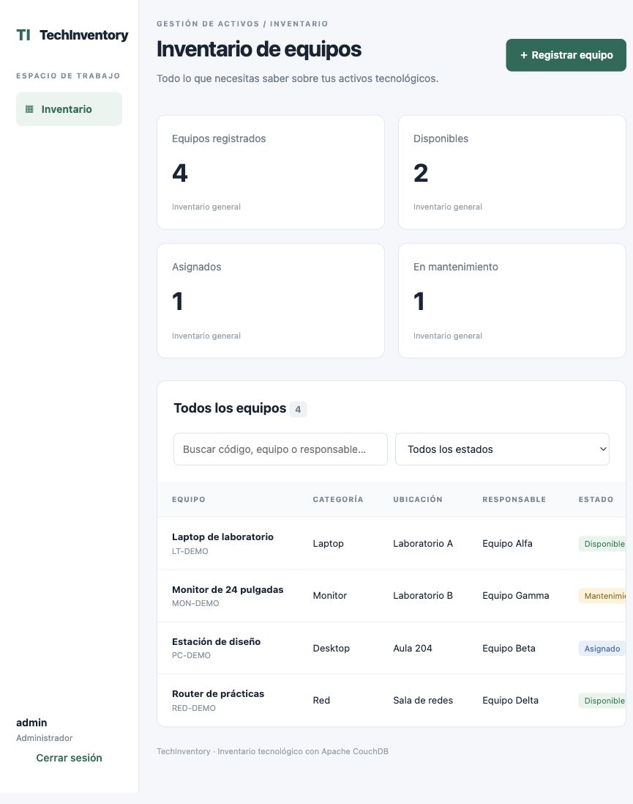
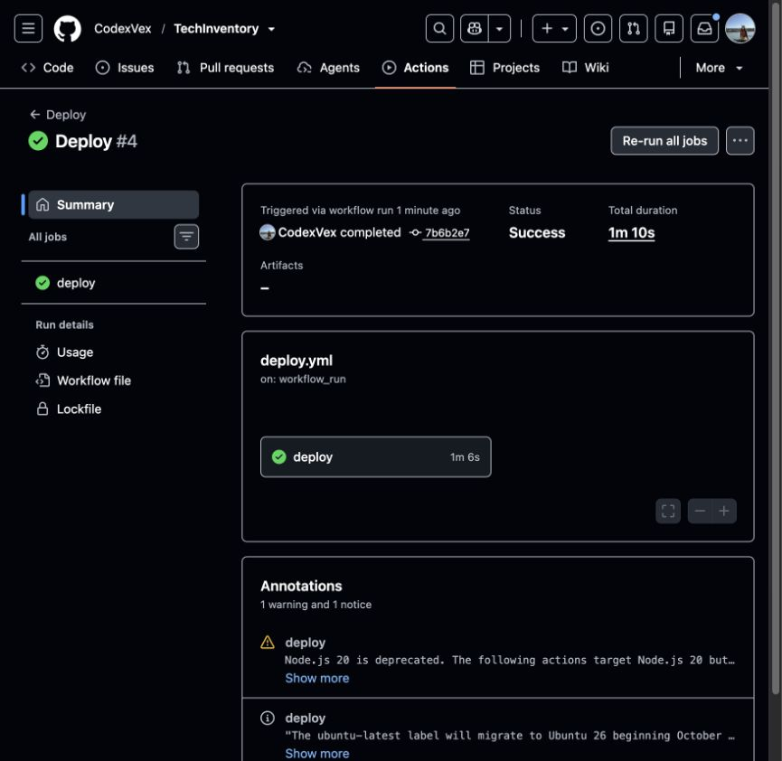

# Del repositorio a HTTPS: automatizar TechInventory sin perder los datos de CouchDB

Autora: Gabriela Cohaila

Una aplicación puede funcionar en la computadora y aun así fallar al publicarse. En TechInventory, el requisito de usar Apache CouchDB añade una condición: los documentos deben sobrevivir al reinicio y al reemplazo de los contenedores. Por eso la elección del alojamiento depende de la persistencia, además del precio.

El proyecto combina React/Vite, Node/Express y CouchDB. Este artículo se concentra en cómo construir, verificar y preparar su publicación automatizada, y en distinguir una configuración disponible de un despliegue realmente observado.

## Una sola aplicación, dos servicios principales

El Dockerfile utiliza dos etapas. La primera instala las dependencias y compila React. La segunda incorpora la API, las dependencias de ejecución y los archivos compilados. Express entrega tanto la interfaz como `/api`, lo que evita configurar dos orígenes para esta demostración.

Compose inicia CouchDB y espera a que responda su comprobación de salud antes de iniciar la aplicación. El directorio de datos de CouchDB se monta en un volumen. Reconstruir la imagen de Express no reemplaza ese volumen.

Las credenciales se generan localmente con valores aleatorios y se guardan en `.env`, excluido de Git. Una imagen reutilizable no debe contener las claves del entorno donde terminará ejecutándose.

## La validación forma parte del recorrido

El workflow CI instala con `npm ci`, ejecuta pruebas de API, compila el frontend y comprueba dependencias. Luego levanta los contenedores y ejecuta la prueba de integración contra CouchDB real.

La primera ejecución falló al iniciar CouchDB. El contenedor ajusta permisos de sus archivos y el montaje de configuración de solo lectura interfería con ese arranque. La solución fue copiar la configuración con el propietario correcto durante la construcción de una imagen derivada de `couchdb:3.5.0`. La [ejecución CI #3](https://github.com/CodexVex/TechInventory/actions/runs/43322534919) completó las seis pruebas de API y la integración real. Esta diferencia entre una prueba aislada y una prueba con el servidor real fue una evidencia concreta del proyecto.

El workflow de despliegue está preparado para iniciarse después de un CI exitoso en `main`. Utiliza el commit que pasó la validación, envía sus archivos al servidor por SSH y ejecuta Compose. Su activación requiere configurar el destino y secretos; no se publica un supuesto resultado mientras esos requisitos falten.

## HTTPS y una base fuera de Internet

La configuración de producción agrega Caddy delante de Express. Caddy recibe tráfico en 80 y 443 y obtiene el certificado para el nombre DNS configurado. Express queda disponible solo en loopback del host y dentro de la red de contenedores. CouchDB no necesita un puerto público.

En producción la sesión usa una cookie Secure y HttpOnly. Las escrituras también requieren un token CSRF y el origen esperado. Usar HTTPS protege el transporte, pero no sustituye la autorización ni la validación de entradas.

## Qué significa realmente gratuito

La documentación de Render indica que sus servicios web gratuitos tienen un sistema de archivos efímero y no admiten disco persistente. Hospedar CouchDB allí como si fuera una base duradera incumpliría el requisito del proyecto. Tener una URL accesible no compensaría perder los documentos al reiniciar.

Azure for Students ofrece crédito académico sin tarjeta. Antes de crear recursos hay que verificar elegibilidad, saldo, vencimiento, cuotas y límite de gasto en la cuenta concreta. Los créditos no convierten una VM en gratuita para siempre: la máquina, el disco y la IP consumen saldo mientras existan según sus tarifas aplicables.

La comparación y la decisión operativa se registran en `docs/hosting.md`. No se habilita pago por uso ni se retira la protección de gasto para completar esta tarea.

## Cómo demostrar la automatización

La evidencia más clara sigue una secuencia pequeña: cambiar un texto visible, subir el commit, observar CI, observar CD y comprobar el cambio en la URL HTTPS. Conviene mostrar el identificador del commit y la ejecución correspondiente para conectar el resultado con el código.

Después se registra un equipo, se reinicia el servicio y se consulta de nuevo. Esa segunda secuencia demuestra persistencia, una propiedad diferente del despliegue automático. Las capturas deben excluir `.env`, claves SSH, cookies y pantallas con datos privados.

El proyecto incluye un guion de menos de cinco minutos. El video debe mostrar resultados reales; las pantallas pendientes se graban después de resolverlas, sin sustituirlas por imágenes ilustrativas.

## Límites y siguientes pasos

La propuesta usa un solo servidor y no ofrece alta disponibilidad. El workflow preparado tampoco aplica una reversión automática si falla una versión nueva. Antes de usar el sistema con información importante se necesitan respaldos con restauración probada, monitorización y una operación de administración de cuentas más completa.

Automatizar no elimina la necesidad de revisar el resultado. Reduce pasos repetitivos y hace visible qué versión se probó y qué versión se intentó publicar. Esa trazabilidad es el principal aprendizaje de TechInventory.

## Código y referencias

- [Repositorio TechInventory](https://github.com/CodexVex/TechInventory)
- [GitHub Actions](https://github.com/CodexVex/TechInventory/actions)
- [Limitaciones del alojamiento gratuito de Render](https://render.com/docs/free)
- [Azure for Students](https://azure.microsoft.com/en-us/free/students/)
- [Límite de gasto de Azure](https://learn.microsoft.com/en-us/azure/cost-management-billing/manage/spending-limit)
- [Volúmenes Docker](https://docs.docker.com/engine/storage/volumes/)
- [HTTPS automático de Caddy](https://caddyserver.com/docs/automatic-https)

## Resultado verificado de la demostración

El 12/11/2026 se publicó TechInventory con HTTPS en una VM Ubuntu de Azure for Students. El [despliegue automático #4](https://github.com/CodexVex/TechInventory/actions/runs/43323181513) terminó correctamente. También se ejecutó CRUD real desde la URL HTTPS y se comprobó que `asset:LT-DEMO` conservaba su identificador y revisión después de reiniciar Express y CouchDB. Los registros y capturas están en [evidence](https://github.com/CodexVex/TechInventory/tree/main/evidence).

La URL utilizada fue `https://techinventory-codexvex-20261112.eastus.cloudapp.azure.com`. El alojamiento es temporal: se retira después de recopilar las evidencias para evitar consumo continuo de créditos. Esa dirección no debe considerarse un servicio permanente. El repositorio y los registros de Actions permiten revisar la construcción y el despliegue aunque el servidor se haya retirado.
